# Video Ads Replication Agent on BytePlus ModelArk - Build and Maintenance Guide

The **Video Ads Replication Agent** is a BytePlus ModelArk Managed Agent. It takes a proven social video ad and delivers a new, publishable 9:16 ad with AI-generated people and your own personalized product. This guide shows your team how to build the same agent, the web app around it and its storage in your own BytePlus account, and how to run, change and maintain it afterwards.

| If you want to... | Read |
|---|---|
| See what it does | 1 Demo, 2 What it does |
| Understand how it works | 3 How the agent works |
| Build it in your account | 4 Get the code, 5 Build it (Parts A-D) |
| Make ads with it | 6 Use it |
| Change, update and keep it healthy | 7 Maintain it |
| Look something up | 8 Reference, 9 Validation and limitations, 10 FAQ, 11 Glossary |

The main console screens have screenshots (in `guide/images/`); the other steps are described in the text.

---

## 1. Demo

[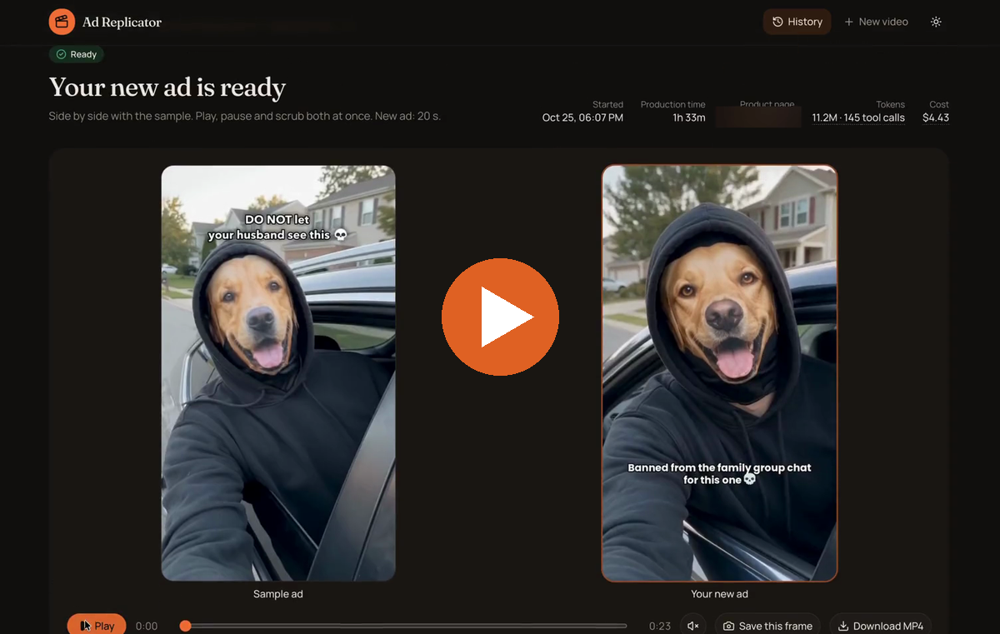](demo.mp4)

*Demo video (3.5 min, no sound). Click the picture to open it; the file is `guide/demo.mp4`.*

| Time | Chapter |
|---|---|
| 0:00 | New video: paste the sample ad's link (a Facebook Reel here, downloaded for you), the product page and a name |
| 0:31 | Your brief, then the output: length, resolution, on-screen text, video and image models |
| 0:59 | Reference files, budget, quality checks and approval options; start the run |
| 1:06 | The run: steps 1-11, outputs as they arrive, paid calls and the raw activity log |
| 2:14 | Results of a finished project: the new ad plays next to the sample |
| 2:40 | Captions and inset: edit, time and animate each caption and the photo inset |
| 2:52 | Clips: the inputs and the exact prompt behind each clip; regenerate one |
| 3:08 | Quality scorecard (C1-C8), request a revision, download everything |
| 3:14 | Another finished ad: a kids' Christmas blanket |

---

## 2. What it does

### 2.1 Overview

Print-on-demand shops live on short-video ads. A personalized blanket, socks with a child's name or a pet-face balaclava sells best when a buyer sees a real-looking family unwrap *their* version. The ads that already work on TikTok and Reels have proven hooks, pacing and moods. What the shop needs is the same ad again with its own product, its own personalization and new faces, without a shoot.

Given a sample ad and a product page, the agent:
- analyses the sample
- casts AI people
- personalizes the product on the shop's own website for each person
- writes and validates the video prompts
- generates the clips
- assembles the ad in the shop's caption style
- checks the result with an independent evaluator before delivering it

A web app lets marketers start runs, approve plans, regenerate single scenes, edit captions and see what each ad cost.

```
                         ┌──────────────────────── BytePlus account (ap-southeast-1) ─────────────────────────┐
  Marketer (browser) ──▶ │ veFaaS web app (FastAPI + Next.js) ──▶ ModelArk Managed Agents                        │
                         │   │  starts runs, shows progress,       ├─ Agent: system prompt + 7 skills (GLM-5.3)  │
                         │   │  approvals, regeneration, editing   ├─ Environment: cloud sandbox                 │
                         │   │                                     ├─ Vault: ARK_API_KEY for the sandbox         │
                         │   │                                     └─ Models: Seedream, Seedance, Seed 2.0 lite  │
                         │   └──▶ TOS bucket (private): every project file, via the function's IAM role        │
                         └───────────────────────────────────────────────────────────────────────────────────────┘
```

### 2.2 Inputs and outputs

| Type | Content | Form |
|---|---|---|
| Sample ad | A proven UGC/TikTok ad for a similar product | Uploaded MP4, a direct MP4 link, or a Facebook / YouTube / Instagram link that the web app downloads (TikTok: upload the file) |
| Product page | The shop's product page with its personalization form | URL |
| Brief | Audience, style notes, things to avoid, approved offer wording, CTA, music, length, resolution | Free text |
| Options | Video and image model, caption mode (full / CTA only / none), approval mode, budget caps | Form fields in the web app |
| References (optional) | Product mockups, look or style references, a music track | Uploaded files, each with a note |

**Output:**
- a publishable 9:16 ad, with and without on-screen text
- preview frames
- the quality report with scores per criterion
- a short delivery report

**What stays and what changes.**
- The ad keeps the sample's world: setting, decor, cast size, shot order, pacing and caption style.
- It changes the product, the people, the names, the brand and the caption wording.

### 2.3 People vs. product

- **People are always new and AI-generated.**
  - The cast matches the sample: as many people, with the same ages and gender mix.
  - The cast is diverse.
  - Never a real person's photo or likeness.
- **The product is never invented.** Its truth is the shop's website.
  - The agent personalizes the product on the live product page for each person.
  - The website's own preview is the product reference.
  - Uploaded mockups add what the preview does not show.

### 2.4 Acceptance criteria (C1-C8)

An independent evaluator scores each criterion from 1 to 5, with evidence:

| | Criterion | Fails go back to |
|---|---|---|
| C1 | Character: AI people look natural and consistent across scenes | People (step 4) |
| C2 | Personalization: name, photo, options correct and legible | Personalize or clip prompt |
| C3 | Setting matches the sample's mood | That clip |
| C4 | Hook in the first 2-3 seconds | That clip |
| C5 | Hook leads to the product | That clip |
| C6 | Product accurate, not deformed | That clip |
| C7 | Personalized area shown clearly | Personalize or clip prompt |
| C8 | Clear CTA, only approved offer wording | Assembly |

**Hard failures** are never delivered as passing:
- misspelled name
- wrong or mirrored personalization
- another brand
- profanity or a rude gesture
- deformed product
- platform UI or a watermark
- wrong cast count
- silent video

---

## 3. How the agent works

### 3.1 The 11 steps

The agent runs eleven steps and reports each with a fixed line that the web app reads:
```
STEP n/11: name - started|done|failed
```
Outputs go to `/mnt/session/outputs/<nn>_<step>/`, and every billable call is logged in `paid_calls.json`.

| Step | Skill | What happens | Output | Gate |
|---|---|---|---|---|
| 1 analyze | ugc-video-analyzer | Frames, contact sheets, motion scores, caption-motion strips; the model writes the brief | `analysis.json` (hook; scenes with camera position, motion, payoff beat, reactions; caption style; cast count; keep; do_not_copy) | Schema check |
| 2 read-product | product-personalizer `probe` | Loads the product page once in headless Chromium | `product.json` (fields, options, photo guide, gallery, size chart) | One page load; stop on HTTP 429 |
| 3 plan | (model) | Cast, options per person (ad-safe), shot list mapped one to one, new captions in the sample's voice, cost estimate | `plan.json` + plain-language plan | Waits for approval unless auto-approve |
| 4 people | generate-with-seedream | One photo per person | `person_<name>.png` | Model review; one more try |
| 5 personalize | product-personalizer `run` | In one page load, for each person: photo, options, name, Preview, capture | `product_<name>.png` (the website's own preview) | Spelling, options, scale, ad safety |
| 6 prompts | ugc-seedance-prompt-craft | `product.spec` written once; one prompt per clip | `prompts.json`, one prompt file per clip | `craft.py validate` must pass |
| 7 clips | generate-with-seedance, ugc-quality-gate | First-frame stills where needed; all clips submitted at once; every clip checked | `clip_NN.mp4`, `clips.json` | A FAIL is fixed and regenerated (max 2) |
| 8 assemble | video-assembly | Cuts on payoff windows, captions in the shop's style and animation, photo inset, shop outro | `final_v<n>.mp4` + text-free master | Refuses copied captions |
| 9 quality-check | ugc-quality-gate | Separate evaluator scores C1-C8, lists hard failures | `report_round_<n>` | PASS / FAIL with routing |
| 10 retries | (routing) | Only the routed step runs again, then 8 and 9 | Round n+1 | Max 3 rounds |
| 11 deliver | (model) | Copy final, master, frames; write the report | `final.mp4`, `final_clean.mp4`, `report.md` | Verdict, scores, paid calls |

### 3.2 Design decisions that made it work

- **The product comes from the live website.**
  - A model invents product details: which side carries the name, the portrait size, the leg pattern.
  - Pasting the product image onto a generated frame looks flat once it moves.
  - So the agent uses the shop's own renderer. The captured preview is the product reference for every still and clip, and the truth every check compares against.
  - The agent writes one `product.spec` sentence and pastes it unchanged into every prompt. Reworded specs once contradicted each other and caused 17 extra video tasks.
- **Some scenes start from a still.**
  - When the sample's setup matters (a driver leaning out of a car window), the agent makes a still from the sample's own staging frame, checks it against that frame, then animates it.
  - Stills never contain pasted artwork.
  - Shots with several personalized items use one image edit per product, then merge them.
- **Batch generation around the 120-second tool limit.**
  - A sandbox tool call ends after 120 s, and a clip takes minutes.
  - So the skills submit all clips at once and keep a background poller; the agent calls `wait` again until nothing is pending.
  - This roughly halved the clip step.
- **An independent evaluator, not self-review.**
  - The agent model's own review missed layout problems.
  - A separate vision model (Seed 2.0 lite) scores the ad and checks every clip.
  - For physics, the model reports per-frame tracks and a script applies the rules: walking backwards, vanishing, size jumps, sliding, hands.
- **Rules where they hold.**
  - Judgment rules live in the system prompt.
  - Anything that can be checked mechanically lives in a skill script: prompt validation, caption originality, file names, budget logging.

---

## 4. Get the code

**Repository:** https://github.com/taylalm/dzt-ugc-agent (branch `main`). Fork or import it into your organization's own Git account, so your changes and releases live in one place you control.

```bash
git clone https://github.com/taylalm/dzt-ugc-agent.git
```

| Folder | What it holds | You change it when... |
|---|---|---|
| `agent/` | `system_prompt.md` (the agent's instructions), `agent_config.json` (a snapshot of the agent's settings) | You change the workflow or rules (7.4) |
| `skills/` | The seven skills, each with `SKILL.md`, `scripts/` and `references/` | You change what a step does (7.3) |
| `tools/ma_client.py` | Command-line client for the Managed Agents API (standard library only) | Rarely |
| `tools/zip_skills.sh` | Packs each skill as a ZIP for uploading in the console | Never |
| `ui/server/` | Web app back end (FastAPI): sessions, sync, cost, bucket, regeneration, caption export | You change the web app (7.6) |
| `ui/web/` | Web app front end (Next.js, exported as static pages) | You change the web app (7.6) |
| `ui/start.sh` | Runs the web app on your computer for testing | Never |
| `.env.example` | The three IDs the tools need; copy to `.env` | Once, at setup (5, Your values) |
| `deploy/vefaas/` | `build_package.sh` builds the veFaaS ZIP | Rarely |
| `guide/` | This guide and its screenshots (`guide/images/`) | When the steps or the console change |

**Not in the repository, on purpose:**

| Item | Why | What to do |
|---|---|---|
| API keys and passwords | Secrets never go into files | Keep them in the vault, the function's environment variables and a password manager |
| Price file `ui/server/prices_local.json` | Prices change and depend on your contract | Optional: create your own (7.10); without it the web app shows time and tokens only |
| Example projects (finished ads, AI people, samples) | Large, and they hold client media | Your own projects are kept in your bucket (Part D) |

---

## 5. Build it

### Before you start

| You need | Notes |
|---|---|
| A BytePlus account with ModelArk, veFaaS, API Gateway, TOS and IAM | Region **ap-southeast-1 (Asia Pacific, Johor)** for everything |
| Permission to create IAM policies and roles | You don't need long-term access keys: this guide uses a role |
| The repository | Section 4 |
| On your computer | Python 3.9+, Node 20+, `bash`, `zip` |

Throughout the guide:
- API base: `https://ark.ap-southeast.bytepluses.com/api/v3`
- Auth header: `Authorization: Bearer $ARK_API_KEY`
- Never write the key into a file; export it in the terminal.

Time to build: about half a day for Parts A-D, if the account already has model access.

### Your values

Fill this in as you go. Every later step refers to it. IDs are not secrets, but keep the table internal.

| Value | Where it comes from | Yours |
|---|---|---|
| Agent ID (`agent-...`) | B4 | |
| Environment ID (`env-...`) | B1 | |
| Vault ID (`vlt-...`) | B2 | |
| Skill IDs and versions (7) | B3 | |
| Optional model endpoint IDs (`ep-...`) | A2 | |
| veFaaS function name | C2 | |
| Web app address | C5 | |
| Bucket name | D1 | |
| IAM policy and role names | D2, D3 | |
| Where the API key and site password are kept | A3, C3 (password manager) | |

**Put your IDs in `.env` once.** `tools/ma_client.py` and the local web app read `MA_AGENT_ID`, `MA_ENV_ID` and `MA_VAULT_ID` from a `.env` file at the repository root. Create it from the example as soon as you have the IDs (after B4), and fill in the three lines:

```bash
cp .env.example .env
```

- There are no built-in IDs. A command that needs a missing one stops and names it (`Setup: MA_AGENT_ID is not set ...`); unedited example values count as missing.
- A variable exported in the terminal wins over `.env`, e.g. to try a second agent for one command.
- `.env` is not committed (`.gitignore`). The IDs are not secrets, so a team can commit its `.env` in its own private fork, so everyone gets the same IDs on clone.
- The API key never goes into `.env`; the tools ignore it there. Export it in each terminal:

```bash
export ARK_API_KEY=...   # your key; never write it into a file
```

---

### Part A - Prepare the account

**A1. Activate the models.** In the ModelArk console, activate these models on the Model activation page. Managed Agents needs no separate activation: its Agents, Sessions, Environments, Credentials Vault and Skills pages are available in the console.

| Model | Model ID | Used for |
|---|---|---|
| GLM-5.3 Flash | `glm-5-3-flash-260828` | The agent |
| Seedream 5.0 pro | `dola-seedream-5-0-pro-260628` | People, stills, edits (default) |
| Seedance 2.5 | `dreamina-seedance-2-5-260628` | Clips (default) |
| Seed 2.0 lite | `seed-2-0-lite-260428` | Clip checks and the quality gate |
| Optional: Seedance 2.0, 2.0 fast and 2.0 mini; Seedream 5.0 flash | `dreamina-seedance-2-0-260128`, `dreamina-seedance-2-0-fast-260128`, `dreamina-seedance-2-0-mini-260615`, `dola-seedream-5-0-flash-260915` | Cheaper or faster runs |

**A2. (Only for the optional models) Create inference endpoints.**
- The web app calls the optional models through your account's endpoints (`ep-...`).
- Create one endpoint per optional model and note the IDs.
- They go into `ui/server/models.py` in step C1.

**A3. Create an API key** on the API keys page.
- Keep it in a password manager.
- You paste it in two places only: the vault (B2) and the veFaaS function (C3).

---

### Part B - The agent on Managed Agents

All of Part B can be done in the ModelArk console, under **Managed Agents** in the left menu (Agents, Sessions, Environments, Credentials Vault, Skills). Terminal commands are given where they are quicker.

**B1. Create the environment.** Environments > **Create Environment**:

| Field | Value | Why |
|---|---|---|
| Environments name | e.g. `ad-replicator-runtime` | Unique per project |
| Environments Description | Optional | |
| Operation mode | **Ark Trust** ("The Ark manages the runtime environment, sessions, and queues") | No servers of your own |
| environment variables | None | The key comes from the vault (B2) |
| Pre-packaged | **Leave empty** | Each skill installs its own tools with `scripts/ensure-deps.sh`. An environment with apt packages failed to start (`SandboxNotReady`) |
| initialization script | Empty | |
| product storage | Leave empty (see D6) | Outputs stay in Ark's managed storage; the web app copies them to your bucket |

Click **Create** and note the **environment ID** (`env-...`).

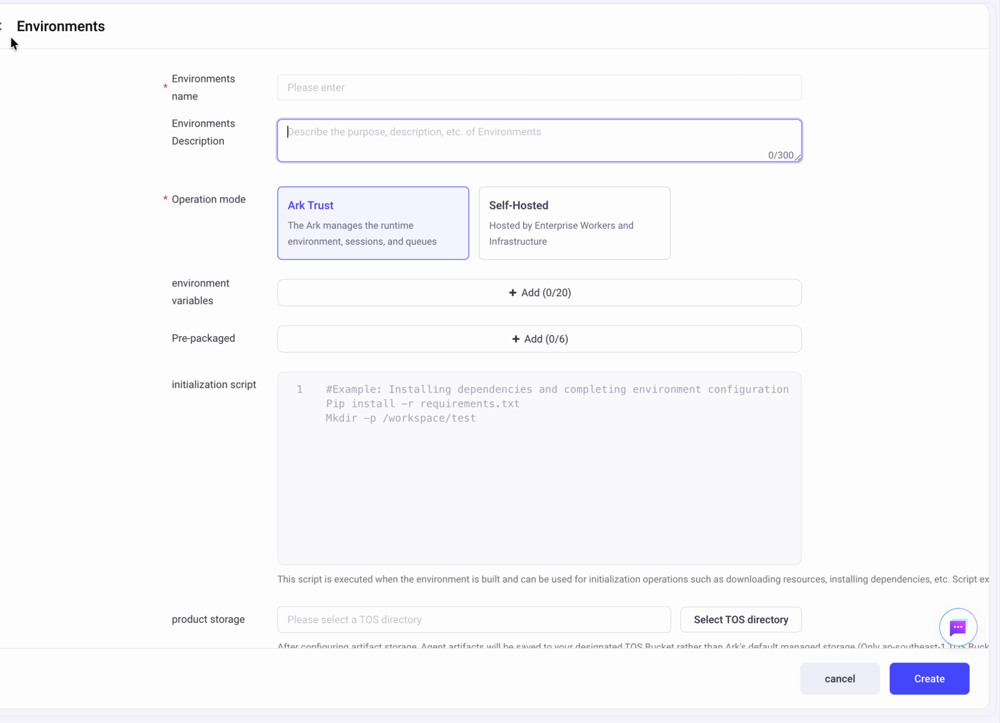
*B1. Create Environment: name, Operation mode "Ark Trust", everything else empty.*

**B2. Create the vault** that holds the model key for the sandbox.
1. Credentials Vault > **Create Vault**, name e.g. `ad-replicator`.
2. Open the vault > **Add Credentials**:

| Field | Value |
|---|---|
| Name | e.g. `ark-api-key` (kebab-case is recommended) |
| Credential type | **ENV** ("Suitable for using CLI and OpenAPI scenarios in the sandbox") |
| Variable name | `ARK_API_KEY` |
| Value | Your API key from A3 |
| Restricted host | `ark.ap-southeast.bytepluses.com` |

- The value cannot be viewed again after saving; to change it, enter it again.
- The sandbox only sees an opaque placeholder. The platform swaps in the real key on the way out to the restricted host, so the agent never sees the key.

Note the **vault ID** (`vlt-...`).

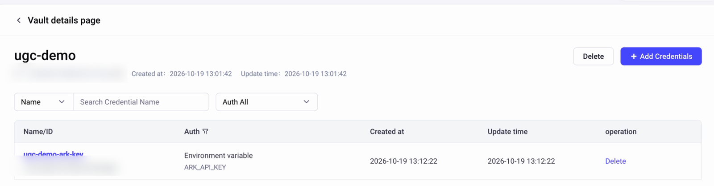
*B2-a. The vault with its credential (type Environment variable, `ARK_API_KEY`).*

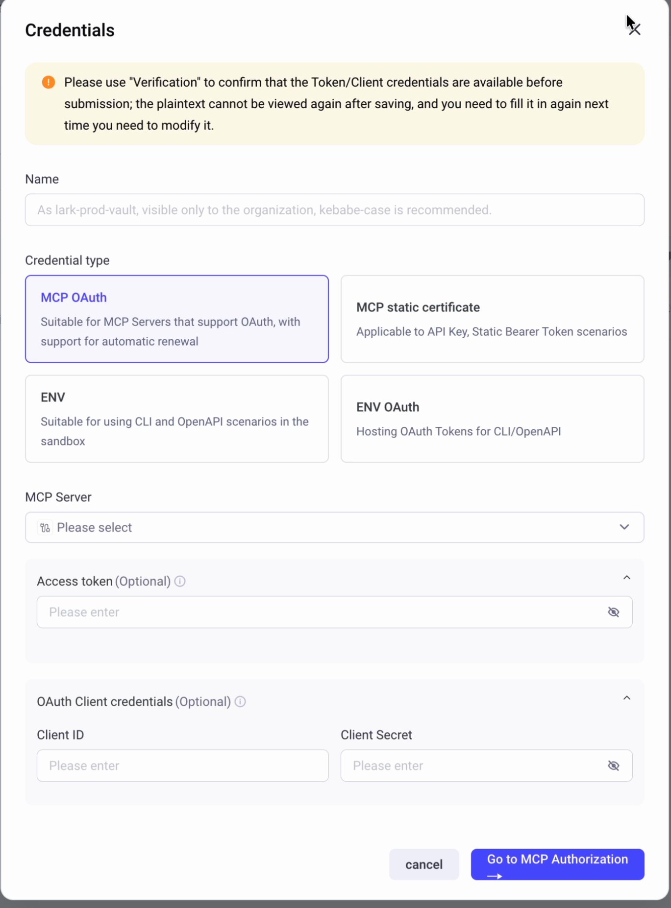
*B2-b. Add Credentials: choose **ENV** as the credential type.*

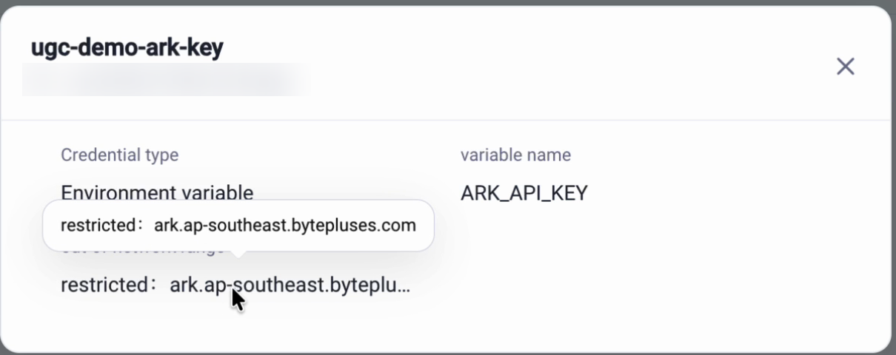
*B2-c. The saved credential: Environment variable `ARK_API_KEY`, restricted to `ark.ap-southeast.bytepluses.com`.*

**B3. Upload the seven skills.**

| Skill | Job |
|---|---|
| ugc-video-analyzer | Sample breakdown (`analysis.json`) |
| product-personalizer | Reads and personalizes the product page in headless Chromium; never adds to cart |
| generate-with-seedream | Seedream images and edits |
| ugc-seedance-prompt-craft | Validated Seedance prompts, first-frame stills, per-product edits |
| generate-with-seedance | Batch clip generation with a background poller |
| video-assembly | Cuts, captions, inset, outro, clean master |
| ugc-quality-gate | Independent evaluator: per-clip checks and the C1-C8 gate |

*In the console:* Skills > **Create Skill**, once per skill.
- **local upload**: choose the skill's folder (e.g. `skills/ugc-video-analyzer`) or a ZIP. The limit is 8 MB, so `video-assembly` (about 12 MB with its fonts and outro) must be uploaded from the terminal instead.
- **GitHub**: the dialog also accepts a public GitHub repository or a skill subdirectory. We have used the folder upload and the terminal; if you try GitHub, check that each of the seven skills is created.

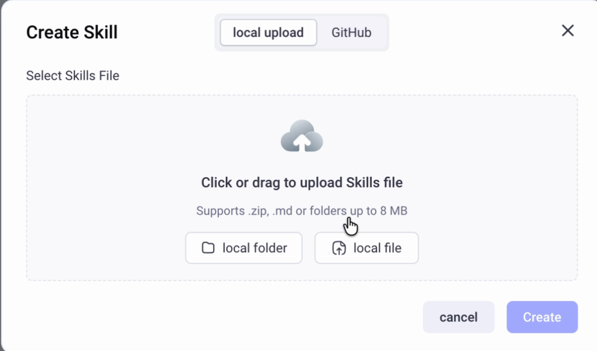
*B3-a. Create Skill: upload a skill folder or ZIP (up to 8 MB).*

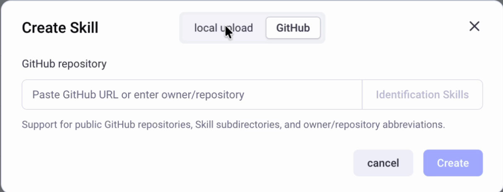
*B3-b. Create Skill from a public GitHub repository or skill subdirectory.*

*In the terminal* (all seven, any size):

```bash
python3 tools/ma_client.py skill create --dir skills/ugc-video-analyzer        --title "UGC video analyzer"
python3 tools/ma_client.py skill create --dir skills/product-personalizer      --title "Product personalizer"
python3 tools/ma_client.py skill create --dir skills/generate-with-seedream    --title "Generate with Seedream"
python3 tools/ma_client.py skill create --dir skills/ugc-seedance-prompt-craft --title "UGC Seedance prompt craft"
python3 tools/ma_client.py skill create --dir skills/generate-with-seedance    --title "Generate with Seedance"
python3 tools/ma_client.py skill create --dir skills/video-assembly            --title "Video assembly"
python3 tools/ma_client.py skill create --dir skills/ugc-quality-gate          --title "UGC quality gate"
python3 tools/ma_client.py skill list      # note each skill_id and its version
```

**B4. Create the agent.** Agents > **Create Agent**. The form has five sections:

| Section | Field | Value |
|---|---|---|
| 01 Basic information | Name | e.g. `ugc-video-agent` |
| | Display name | e.g. `Ad Replicator` |
| 02 model configuration | Model | **GLM-5.3-Flash** (`glm-5-3-flash-260828`) |
| 03 System Prompt | System | The full content of `agent/system_prompt.md` |
| 04 Capability expansion | Skills | **Add Skills** > tick all seven skills from B3 > Confirm |
| | Tools | Toolset (system toolset), all 8 tools ticked, each **full access** |
| | Custom Tools, Multi Agents, MCPs | None |
| 05 Advanced parameters | Base Agent | Leave the default |
| | Context compression threshold | `192000` tokens |

Click **Create** and note the **agent ID** (`agent-...`). Put it, with the environment and vault IDs, in `.env` (5, Your values).

**Skill versions.** Each skill on the agent shows a version selector, "default latest" or a fixed version.
- With **default latest**, the console says a new skill version is used automatically.
- With a **fixed version**, you choose when the agent moves to a new version (7.3). Fixed versions make releases deliberate and easy to roll back; this is how the original agent is set up.

Every later change to the prompt, model or skills creates a new agent version.

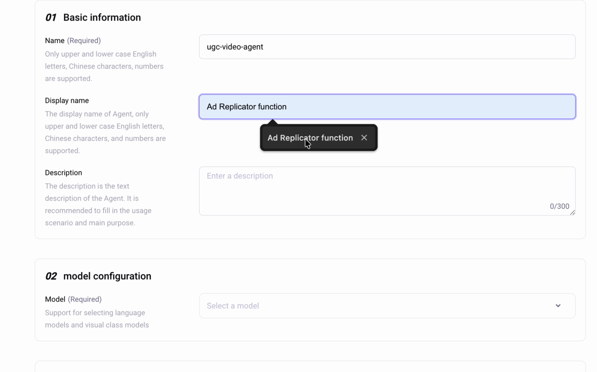
*B4-a. 01 Basic information and 02 model configuration.*

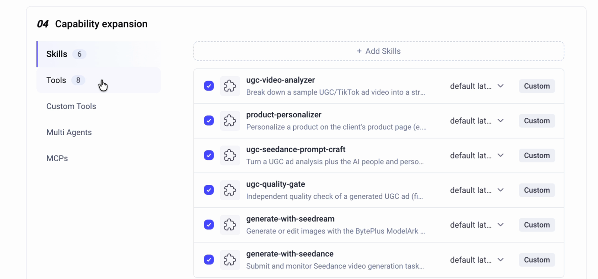
*B4-b. 04 Capability expansion > Skills: the added skills, each with its version selector.*

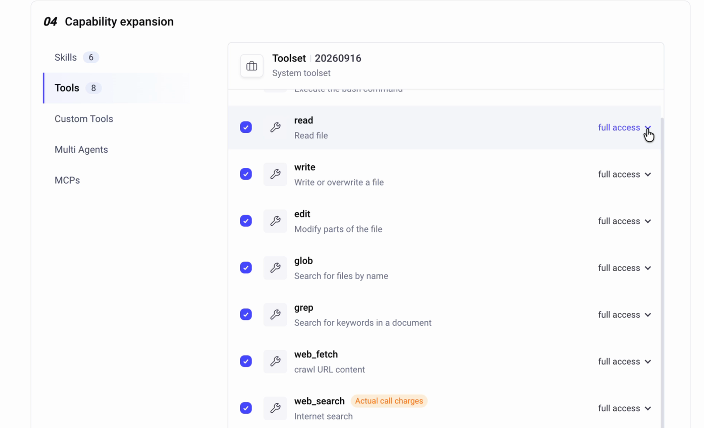
*B4-c. Tools: the system toolset, every tool on full access.*

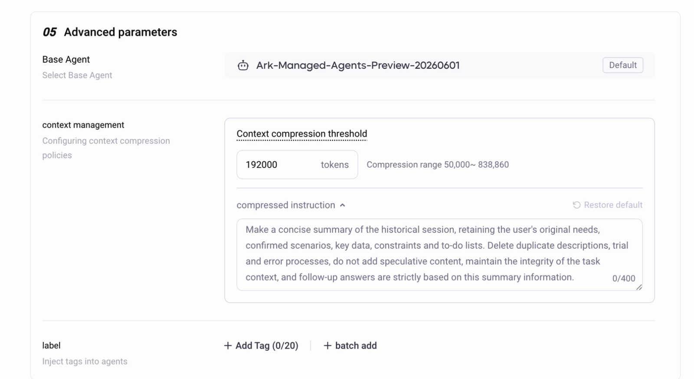
*B4-d. 05 Advanced parameters: default Base Agent, context compression threshold 192000.*

To set the prompt and skills from the terminal instead:

```bash
python3 tools/ma_client.py agent set-system --file agent/system_prompt.md
python3 tools/ma_client.py agent set-skills --skill <skill_id>=<version> --skill <skill_id>=<version> ...
```

`set-skills` replaces the agent's whole skill list: always pass all seven skills.

**B5. Smoke test in a session.** Send a short test message that states its purpose. A bare command was once refused as "probing skill internals".

```
Setup check for the ad agent: list the folders in /mnt/skills and report the Node and Python versions. Do not generate anything.
```

*In the console:* Sessions > **Create Session**:
1. Session Name: e.g. `setup-check`.
2. Agent selection: your agent.
3. Credential: your vault.
4. Environment: your environment.
5. Click **Create and enter debugging**, then send the message above.

*Preview mode* shows the conversation; *Debug mode* shows every event (model requests, tool calls, tokens).

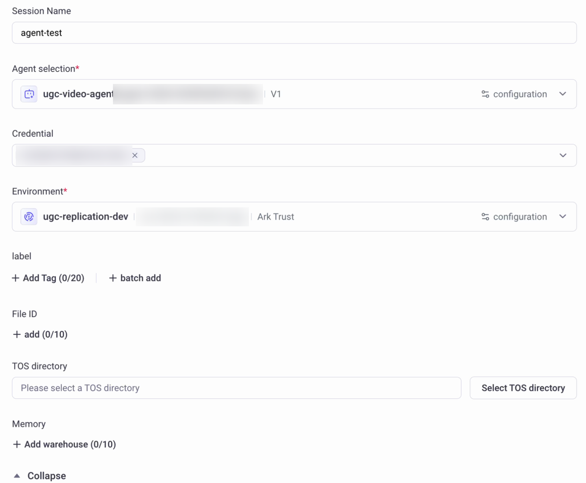
*B5-a. Create Session: agent, credential (the vault) and environment.*

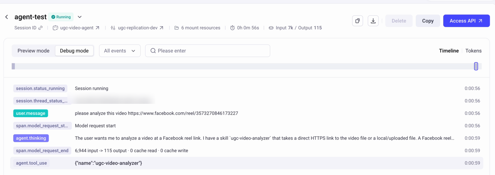
*B5-b. A running session in Debug mode: the message, the agent's thinking and its tool calls.*

*In the terminal:*

```bash
echo "Setup check for the ad agent: list the folders in /mnt/skills and report the Node and Python versions. Do not generate anything." > /tmp/setup_check.txt
python3 tools/ma_client.py run --prompt-file /tmp/setup_check.txt --title "Setup check"
```

The run is saved under `runs/<session-id>.json`.

Expected either way:
- the seven skill folders under `/mnt/skills/`
- Python 3.12 and Node 20

---

### Part C - The web app on veFaaS

**C1. Prepare and build the package.** On your computer:

1. One-time setup of the build tools:

```bash
cd ui && python3 -m venv .venv && .venv/bin/python -m pip install -r server/requirements.txt
(cd web && npm ci) && cd ..
```

2. If you created endpoints in A2, put their IDs in `ui/server/models.py`: the `endpoint` of each optional model. `None` means the public model ID is used.
3. Build the ZIP:

```bash
SHOWCASE_JOBS="" bash deploy/vefaas/build_package.sh
```

The result is `deploy/vefaas/dist/ad-replicator-vefaas.zip`, about 150-200 MB. It holds:
- the server and the built web pages
- the video-assembly and quality-gate scripts the web app reuses
- every Python dependency for Linux x86_64 / Python 3.11, so nothing installs on the function

`SHOWCASE_JOBS=""` builds the package without example projects.

**C2. Create the app.** veFaaS console (Function Service) > **App** > **My app** > **Create app**:
1. Choose **Custom create** > **Code** (a package created by uploading code).
2. Fill in the form:

| Field | Value | Why |
|---|---|---|
| App name | e.g. `ad-replicator` | The name cannot be changed after creation |
| Code source type | **Code** | You upload the ZIP from C1 |
| Select code package | `ad-replicator-vefaas.zip` | Up to 1024 MiB, not encrypted |
| Frame type | Custom | |
| Operating environment | **Native Python 3.11** | Matches the bundled dependencies |
| Startup command | `bash run.sh` | The code folder is read-only: never chmod or write there |

3. Click **Create app**. The app creates a web app function, which is also listed under Function > Function management.

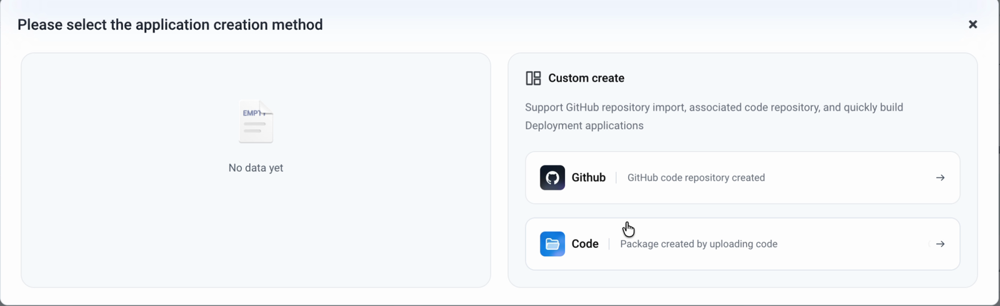
*C2-a. Create app: Custom create > Code.*

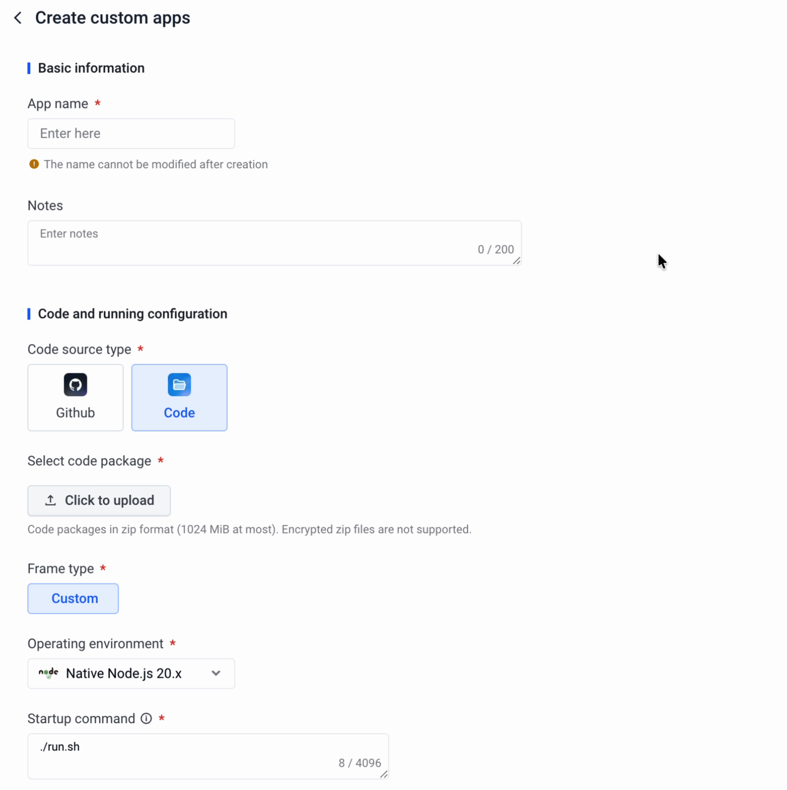
*C2-b. The Create custom apps form. Pick Native Python 3.11 and the startup command `bash run.sh`.*

Then open the app's function > **Function settings** and check or edit the runtime:

| Setting | Value | Why |
|---|---|---|
| Listening port | `8000` | |
| Execution timeout | 900 s | Large uploads and exports run inside one request |
| Instance specification | 1 vCPU / 2 GiB (2 vCPU / 4 GiB for several users at once) | Caption exports and rebuilds use ffmpeg |
| Maximum instances | **1** | Chunked uploads, downloads and edits keep state in the instance |

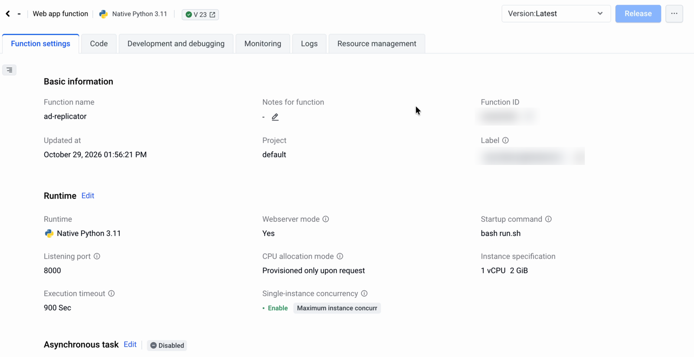
*C2-c. Function settings: Native Python 3.11, `bash run.sh`, port 8000, 900 s, 1 vCPU 2 GiB.*

**C3. Environment variables.** Function settings > Environment variables > **Edit**:

| Name | Value |
|---|---|
| `ARK_API_KEY` | Your API key (A3) |
| `MA_AGENT_ID` | Your agent ID (B4) |
| `MA_ENV_ID` | Your environment ID (B1) |
| `MA_VAULT_ID` | Your vault ID (B2) |
| `UI_BASIC_AUTH` | `<user>:<password>` puts the site behind a sign-in. Recommended: anyone with the link can start paid runs |
| `TOS_BUCKET`, `TOS_ENDPOINT`, `TOS_REGION` | Added in Part D |
| Optional | `UI_AUTO_RESUMES` (default 3; raise it for many users at once), `UI_SHOW_COST` (0 hides amounts) |

Values are hidden in the list; **Copy all variables** copies them.

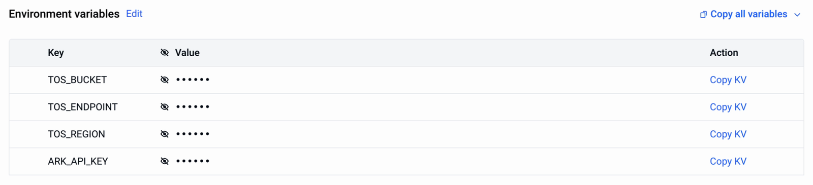
*C3. The environment variables list (values hidden). Add every variable in the table above.*

**C4. Upload a new ZIP and release.** Needed for every later update of the web app:
1. The function's **Code** tab > **Upload** > Upload zip file > choose `ad-replicator-vefaas.zip` > Okay. Confirm that it overwrites the current code.
2. Click **Release** (top right).

- Large browser uploads can stall; keep the ZIP under about 200 MB.
- **Deployment history** lists every release, with **Roll back** to an earlier one.

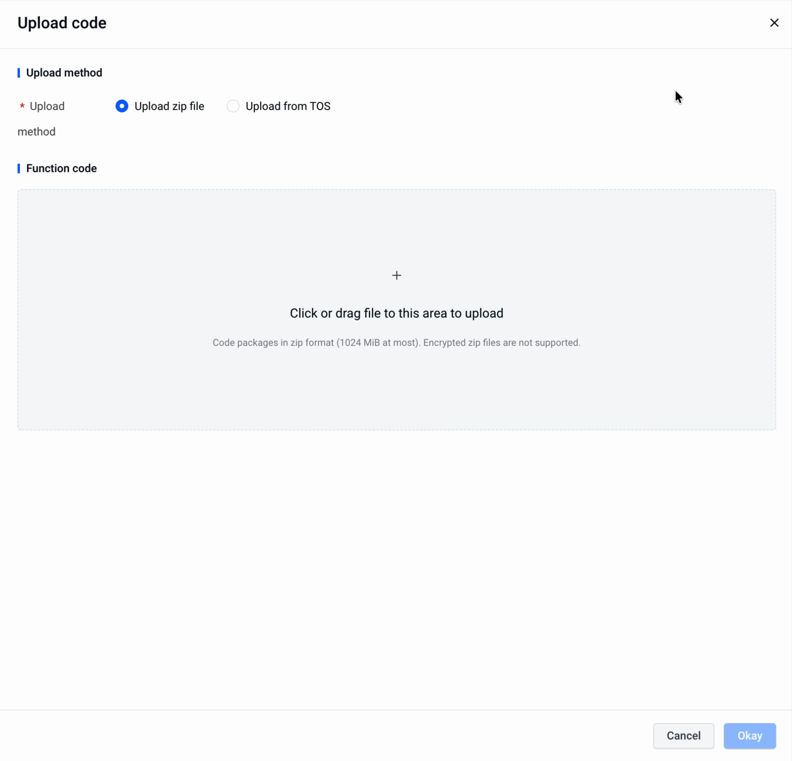
*C4-a. Code > Upload: upload the zip file, then Release.*

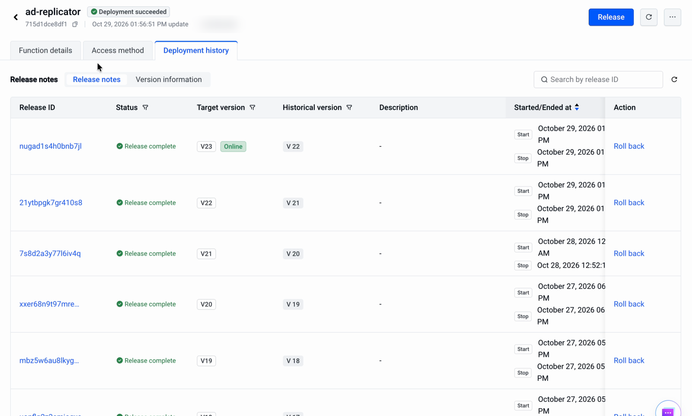
*C4-b. The app's Deployment history: every release, with Roll back.*

**C5. Add the API Gateway trigger.**
1. Add an **API Gateway** trigger to the function, route path `/`.
2. In the gateway's plugins, raise **Rate limiting** to 100 QPS or more. The default (about 1 QPS per replica) returns HTTP 429 as soon as a page loads its images.

- The gateway routes GET, POST and DELETE but **not PATCH**. The web app only uses the first three.
- The public address is under **Copy address** on the app card in My app.

**C6. Check it.** Open the public address (`https://<id>.apigateway-ap-southeast-1.apigw-byteplus.com/`):

| Check | Expected |
|---|---|
| `/api/health` | `{"ok": true, "api_key_present": true, "agent": "<your agent id>", "missing_settings": [], ...}` |
| `/` | Sign-in prompt (if `UI_BASIC_AUTH` is set), then "Your videos" |
| New video > upload a short MP4 | Upload completes; a job starts and shows step 1 |

---

### Part D - Permanent storage with TOS

Files the agent produces can be downloaded from ModelArk for only about a day. So while a run is going, the web app:
- copies every file and record of each project into your own private bucket
- serves projects from the bucket
- rebuilds its project list from the bucket after a restart

The function reaches the bucket through an **IAM role**, so there is no long-term key anywhere.

**D1. Create the bucket.** TOS console > **Create bucket**:

| Setting | Value | Why |
|---|---|---|
| Name | e.g. `<company>-ad-replicator-assets` | |
| Region | Asia Pacific (Johor) | Same region as ModelArk and veFaaS |
| Versioning | Inactive | Every file has a new name; versions only add cost |
| Bucket policy | **Private** | Ads, AI people and samples must not be public |
| Object ACL default | default private | |
| Default storage type | Standard | Files are played and downloaded often |
| Server-side encryption | SSE-TOS (or None) | |
| Hierarchical namespace, Multi-AZ, Log analysis, RenameObject | Off | Not needed |
| **Retention policy** | **Off** | A retention lock would block "Delete project" |

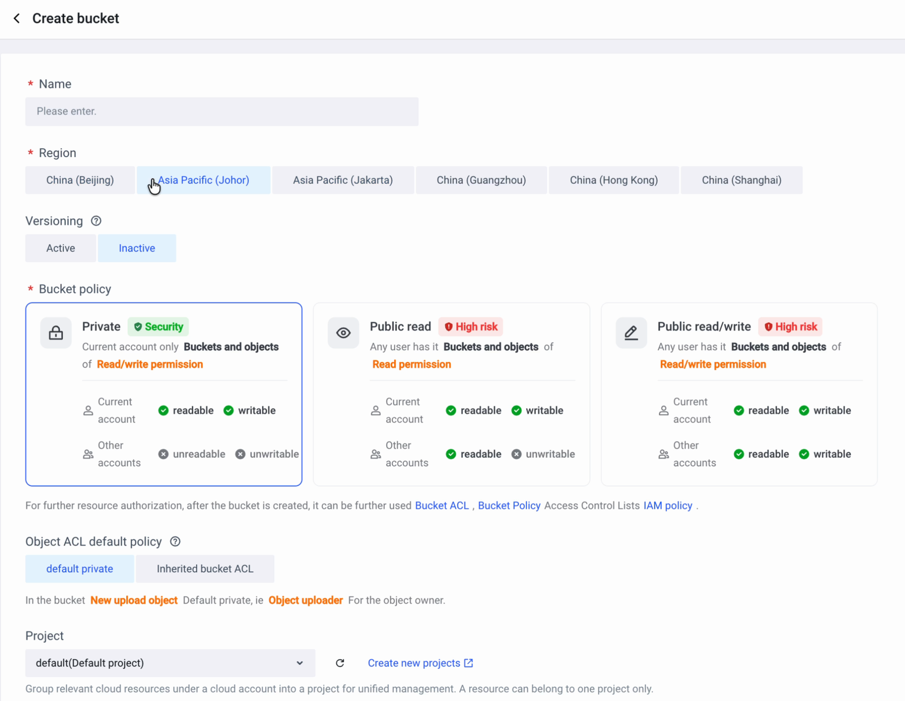
*D1-a. Create bucket: name, region Asia Pacific (Johor), versioning Inactive, bucket policy **Private**, object ACL default private.*

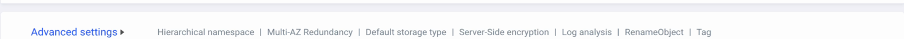
*D1-b. **Advanced settings** (click to expand) holds hierarchical namespace, Multi-AZ, default storage type, encryption, log analysis, RenameObject and tags. Check the retention policy is off.*

**D2. Create a permission policy for that bucket only.** IAM > Permission policy > **Create policy** > JSON, name e.g. `AdReplicatorAssetsBucket`:

```json
{
  "Statement": [
    {
      "Effect": "Allow",
      "Action": ["tos:Get*", "tos:ListBucket", "tos:PutObject", "tos:DeleteObject"],
      "Resource": [
        "trn:tos:::<your-bucket>",
        "trn:tos:::<your-bucket>/*"
      ]
    }
  ]
}
```

- It allows reading, listing, uploading and deleting files in this one bucket.
- It cannot touch other buckets or change the bucket itself.

**D3. Create a role the function can use.** IAM > Role management > Role > **Create new role**:

| Step | Value |
|---|---|
| Trusted identity | **Services**, service `vefaas` |
| Create as a service-associated role | **Unticked** (that system role cannot be customized) |
| Role name | e.g. `AdReplicatorFunctionRole` |
| Permissions | Only `AdReplicatorAssetsBucket` (D2) |

**D4. Bind the role and point the app at the bucket.** veFaaS > your function > Function settings:

1. **Permission > Edit** > Function role: `AdReplicatorFunctionRole` > Save.
2. **Environment variables > Edit**: add
   - `TOS_BUCKET=<your-bucket>`
   - `TOS_ENDPOINT=tos-ap-southeast-1.bytepluses.com`
   - `TOS_REGION=ap-southeast-1`
3. **Release**. An orange "Update available" tag means the change is saved but not live yet.

The platform now passes the role's temporary keys with every request to the function; the web app keeps the newest and uses them for the bucket.

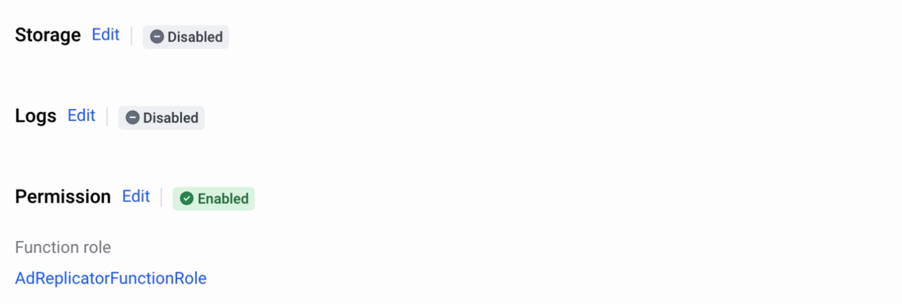
*D4-b. Permission section "Enabled" with the role name.*

**D5. Check it.** Open `https://<your address>/api/storage`. Expected:

```json
{"bucket": "<your-bucket>", "configured": true, "credentials": "function role",
 "ok": true, "read_back": true, "signed_link": true, ...}
```

Within a few minutes of a run:
- `uploads` grows
- project videos are served from `<your-bucket>.tos-ap-southeast-1.bytepluses.com`

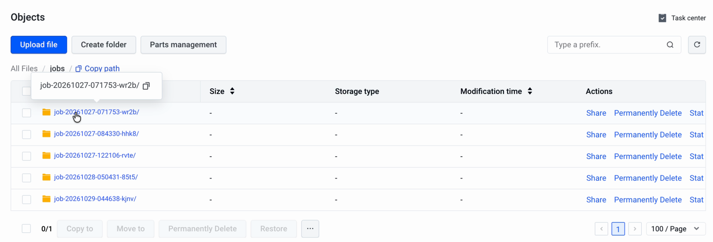
*D5-a. Buckets > your bucket > Objects > `jobs/`: one folder per project.*

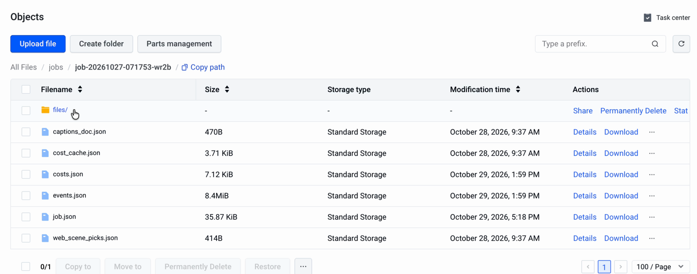
*D5-b. Inside a project folder: its records (`job.json`, `events.json`, `costs.json`, ...) and `files/` with every image and video.*

**D6. An alternative to know about: the environment's own artifact storage.**
- The Managed Agents environment has a **Product storage** option (`config.tos`).
- Output files are then written straight into your bucket under `{prefix}outputs/{env-id}/{session-id}/`, and are not deleted with the session.
- It needs the bucket authorized in the ModelArk project, in the same region.
- It has not been tested with this agent; the web app's copy (D1-D5) is the tested path.

---

## 6. Use it

**6.1 Make an ad.**
1. In the web app, click **New video**.
2. Add the sample: upload it, or paste a Facebook / YouTube / Instagram link.
3. Paste the product page URL.
4. Write the brief: audience, what to avoid, approved offer wording, CTA.
5. Choose the video and image models, the caption mode and the approval mode, then click **Start**.

**6.2 Approve the plan.**
- The plan shows the cast, the options per person, the shot list next to the sample's scenes, the new captions and the cost estimate.
- Approve it, or ask for changes in plain words.
- With auto-approve on, the run continues without waiting.

**6.3 Follow the run.** Each step shows its outputs as they arrive: people, website previews, stills, clips with their check verdicts. A run usually takes about an hour.

**6.4 Review the result.** The final plays next to the sample, with:
- the C1-C8 scores and their evidence
- hard failures, if any
- time and cost by step

**6.5 Fix a scene.**
1. Under a clip or still, write what to change, in any language. Pictures or short videos can be attached.
2. The agent writes a draft (an English prompt and inputs) without generating anything.
3. Review or edit the draft, then click **Generate**.
4. Compare the new take with the current one and its check result.
5. Click **Use this take**, then **Rebuild final**.

The scene picker lists every take of a scene.

**6.6 Edit captions.**
- Move, edit, retime or turn off each caption and the photo inset.
- Effects: fade, pop, slide up, word by word, typewriter.
- Export a new MP4. The agent's original stays available.
- "All text off" gives the text-free master.

**6.7 Download, rename, delete.**
- Every asset has its own download button, and the bottom of the page offers everything as one ZIP.
- Rename a project with the pencil icon.
- **Delete** removes the project from the site, the bucket and the agent session.

---

## 7. Maintain it

### 7.1 What to change where

| You want to change... | Change this | Release with |
|---|---|---|
| Workflow, rules, tone of the plan | `agent/system_prompt.md` | 7.4 |
| How the sample is analysed | `skills/ugc-video-analyzer` | 7.3 |
| How the product page is read and personalized | `skills/product-personalizer` (`scripts/personalize.py`, `references/action_plan.md`) | 7.3 |
| Prompt rules for Seedance | `skills/ugc-seedance-prompt-craft/references/seedance25_rules.md`, `ugc_shot_patterns.md`, `scripts/craft.py` | 7.3 |
| Quality criteria and pass marks | `skills/ugc-quality-gate/references/rubric.md`, `scripts/gate.py` | 7.3 |
| Caption styles | `PRESETS` and `POSITIONS` in `skills/video-assembly/scripts/assemble.py` | 7.3 **and** 7.6 (the web app's caption editor uses the same code) |
| Outro (end card video) | `skills/video-assembly/assets/outro/` and `DEFAULT_OUTRO` in `assemble.py` | 7.3 and 7.6 |
| Which models the agent may use | Model table in the system prompt and the skills' `SKILL.md` | 7.4, 7.3 |
| Models and endpoints the web app offers | `ui/server/models.py` | 7.6 |
| The agent model | `ma_client.py agent set-model --model <id>` | New sessions use it |
| Web app pages and behaviour | `ui/web/src`, `ui/server` | 7.6 |
| Site password, key, bucket, IDs | Function environment variables | Release the function |

### 7.2 Test before you release

| Change | Free test |
|---|---|
| A skill script | Run it locally where possible; most scripts have `--dry-run` (Seedream, Seedance, prompt craft, assembly, quality gate), which builds the request without a paid call |
| The system prompt | One test run in a new session with a cheap model choice (Seedance 2.0 mini, Seedream 5.0 flash, 480p) |
| The web app | Run it on your computer: `ARK_API_KEY=... ui/start.sh` (the IDs come from `.env`), then open `http://localhost:3000` |

Keep one short sample and one product page as your fixed test case, so results stay comparable between releases.

### 7.3 Release a skill change

1. **Upload the new version.**
   - In the console: Skills > open the skill > **Update Skills**, then upload the folder (up to 8 MB).
   - Or in the terminal (any size): see the commands below.
2. **Point the agent to it.**
   - If the agent's skill is set to **default latest**, the console says the new version is used automatically.
   - If it is set to a fixed version, edit the agent and pick the new version, or run `agent set-skills`.

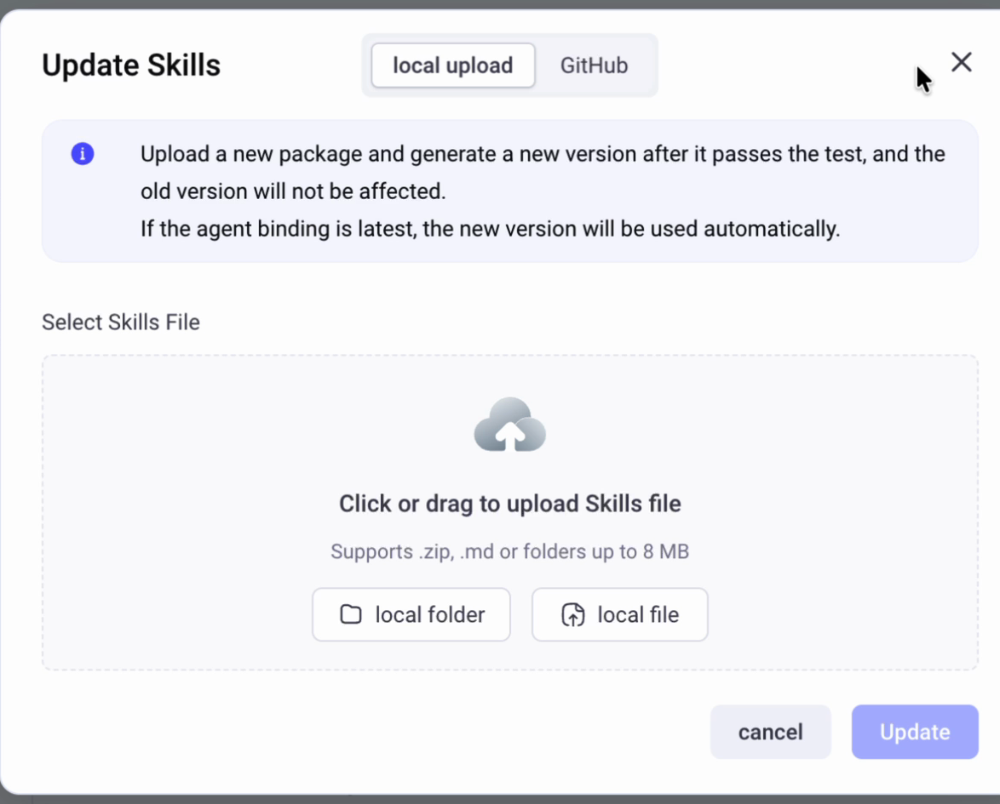
*7.3. Update Skills: the new version leaves the old one untouched; agents bound to "latest" use it automatically.*

In the terminal:

```bash
python3 tools/ma_client.py skill upload --skill-id <id> --dir skills/<name>    # new skill version
python3 tools/ma_client.py skill versions --skill-id <id>                      # note the new version
python3 tools/ma_client.py agent set-skills --skill <id>=<version> ...          # all seven skills; new agent version
```

- Only sessions started **after** that use it: a session pins the agent version when it is created.
- Check it in a new session, e.g. with the skill's `--dry-run`.
- Write the new version into your values table and commit the change with a tag (e.g. `skills-assembly-v19`).

### 7.4 Change the system prompt

1. Edit `agent/system_prompt.md`.
2. Run `python3 tools/ma_client.py agent set-system --file agent/system_prompt.md`.

New sessions pick it up; running sessions keep the old prompt.

**Keep the progress protocol intact.** The web app reads the `STEP n/11` lines and the message keywords (APPROVE, CHANGES, REGENERATE, DRAFT, ADD CLIP, REVISION, USE TAKE). Renaming them breaks the progress display.

### 7.5 Versions and rollback

- Every agent update creates a new agent version.
- `python3 tools/ma_client.py agent versions` lists them.
- `python3 tools/ma_client.py agent get --save agent/agent_config.json` saves the current settings: prompt, model and skill versions.

Save and commit that file after every release, so Git shows which prompt and skill versions were live and when.

**To roll back**, apply the earlier settings again. This creates a new version with the old content:
1. `git checkout <tag> -- agent/system_prompt.md`
2. `agent set-system`
3. `agent set-skills` with the earlier skill versions (old skill versions stay available)

### 7.6 Update the web app

1. Rebuild the ZIP (C1).
2. Upload it in the function's Code tab and click Release.

Environment variables, the role and the bucket stay. Projects are rebuilt from the bucket after the restart; runs in progress continue, and the web app picks them up again.

To undo a release, open the app's **Deployment history** and click **Roll back** on the earlier release (C4-b).

### 7.7 Shop-specific settings

The agent is generic; these parts carry the shop's identity. Update them when the brand changes, or when you set the agent up for another store:

| Item | Where |
|---|---|
| Business description and website | First paragraph of `agent/system_prompt.md` |
| Outro video (logo, service badges, AI-performer note) | `skills/video-assembly/assets/outro/` |
| Caption styles measured from the shop's own ads | `PRESETS` in `assemble.py` |
| Brand name the evaluator treats as correct (not "other brand") | `client_brand` in the quality gate's context (`scripts/gate.py`) |
| CTA wording expected by C8 | `skills/ugc-quality-gate/references/rubric.md` |
| Web app accent colour | `ui/web/src/app/globals.css` |

### 7.8 New products and new samples

- **A new product on the same website** usually needs nothing.
  - The personalizer reads each page's form at step 2 (probe).
  - If a page uses a new kind of control, the agent stops and reports it; extend `personalize.py` and release the skill.
- **A product page that does not draw the personalization in its preview:**
  - The agent stops and asks: compose from the site's own render, use uploaded mockups, or skip.
  - Upload good mockups as references for such products.
- **Ad safety of product artwork:** design options (animals, characters) can contain rude gestures or other brands. The agent checks them and picks safe options. If every option is unsafe, it stops for a decision.
- **A new kind of sample** (a shot pattern the agent handles poorly): add the pattern to `ugc_shot_patterns.md` with what to do, then release the prompt-craft skill.

### 7.9 Monitoring and logs

| Where | What you see |
|---|---|
| Web app, project page | Steps, outputs, check verdicts, quality report, time and cost by step |
| `/api/health` | API key present, agent ID, settings still missing, projects currently syncing |
| `/api/storage` | Bucket reachable, credentials from the function role, uploads count |
| Managed Agents console > Sessions | Every session's events: messages, tool calls, errors |
| `python3 tools/ma_client.py session events <session-id>` | The same from the terminal |
| veFaaS console, the function's **Monitoring** tab | Requests, latency, errors, CPU, memory and instances over time |
| veFaaS console, **Logs** tab (enable Logs in Function settings first; it is off by default) or **Resource management** > instance > Logs | Web app errors, restarts, uploads |

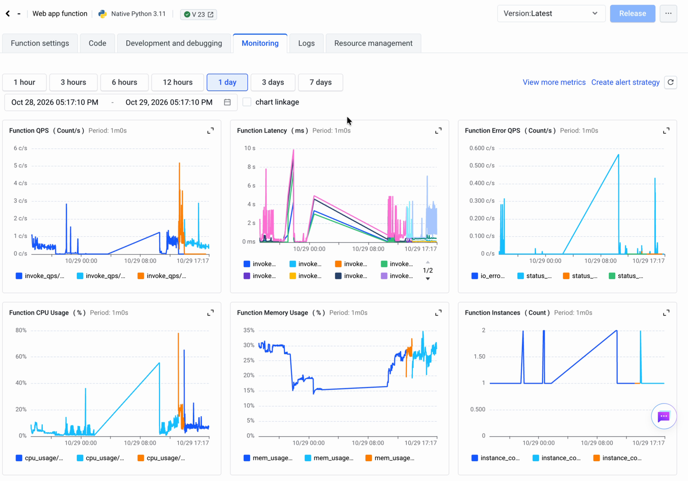
*7.9. The function's Monitoring tab.*

### 7.10 Cost

- **Managed Agents bills:**
  - the agent's tokens
  - its running time ($0.08 per hour, only while the session runs)
  - web search calls ($0.006 each)
- **Billed as model calls:** images, videos and checks. Seedance is most of an ad's cost.
- Choose cheaper models per run in the New video form (Seedance 2.0 fast or mini, Seedream 5.0 flash, 480p) for tests and drafts.

The web app shows time, tokens and list-price cost per step. To show amounts, place your own price file at `ui/server/prices_local.json` before building (C1). It is kept out of Git on purpose. Take the prices from the official ModelArk pricing page:

| Key | Meaning |
|---|---|
| `source`, `currency` | Where and when the prices were read; e.g. `USD` |
| `seedance_per_m`, `seedance_with_video_per_m` | Seedance 2.5 price per million tokens by resolution (`{"480p": ..., "720p": ..., "1080p": ...}`), without and with video input |
| `seedance_per_m_by_model`, `seedance_with_video_per_m_by_model` | The same per model ID, for the other Seedance models |
| `seedream_image_small`, `seedream_image_large`, `seedream_tier_pixels` | Seedream 5.0 pro price per image below and above the pixel tier |
| `seedream_flash_image` | Seedream 5.0 flash price per image |
| `agent_input_per_m`, `agent_cached_per_m`, `agent_output_per_m` | Agent model tokens |
| `evaluator_input_per_m`, `evaluator_output_per_m`, `evaluator_call_estimate` | Evaluator tokens and the estimated cost per check |
| `agent_runtime_per_h`, `web_search_per_call`, `web_fetch_per_call` | Managed Agents runtime and tools |

Without the file, every amount is 0 and the web app shows time and tokens only.

### 7.11 Security

- **Keys** live only in the vault and the function's environment variables, never in files, prompts or Git.
- **Sign-in:** keep `UI_BASIC_AUTH` set; anyone who opens the site can start paid runs.
- **Bucket:** stays private; files are shared with signed links that expire.
- **The role** only allows this one bucket.
- **Rotating the API key:**
  1. Create a new key.
  2. Update the vault credential and the function's `ARK_API_KEY`, then Release.
  3. Run one setup check (B5).
  4. Delete the old key.
- **Changing the site password:** update `UI_BASIC_AUTH`, then Release.
- **Leaving team members:** change the site password and remove their console access.

### 7.12 Routine checks

| When | Check |
|---|---|
| After every release | `/api/health`, `/api/storage`, one test run on your fixed test case |
| Weekly | Failed or stalled runs on the project list; Managed Agents sessions left running |
| Monthly | Model list on the official docs (new versions, retirements); bucket size; unused projects deleted; key and password rotation if your policy asks |
| When a model version is retired | Update the model ID in the system prompt, the skills and `ui/server/models.py`; test; release |

### 7.13 Troubleshooting

| Symptom | Cause | Fix |
|---|---|---|
| Environment never starts (`SandboxNotReady`) | Pre-packaged apt dependencies | Leave dependencies empty; skills install their own |
| `apt` fails in the sandbox | Plain HTTP is blocked | Skills switch apt to an HTTPS mirror (built in) |
| `ma_client.py` prints `Setup: MA_... is not set` | No `.env`, an example value left unedited, or the ID not exported | Fill in `.env` (5, Your values) |
| New video says "This site is not set up yet"; `/api/health` lists `missing_settings` | An ID is missing from the function's environment variables | C3: add it, then Release |
| A run stops with `model_rate_limited_error` | Too many sessions at once for the agent model | The web app resumes it; keep 3 or fewer runs at once, or raise `UI_AUTO_RESUMES` |
| Seedance refuses an input image or video | It shows a real person (privacy filter, not billed) | Use AI people only; describe the sample in words; faceless staging frames are fine |
| Seedance clip has unwanted audio, or a copyright rejection | Audio is on by default | Skills send `generate_audio: false` unless natural sound is asked for |
| Seedream 5.0 pro rejects a request | `sequential_image_generation` sent | Skills leave it out |
| Project videos go blank after a day | ModelArk file links expire | Part D (bucket) |
| `/api/storage` shows `ok: false` | Role not bound, policy missing an action, or the function not released | D3-D4; Release |
| "This job does not exist" right after a restart | New instance had not rebuilt its list | Fixed in the app: it looks the project up before answering |
| HTTP 429 when a page loads | Gateway rate limiting default | C5: raise to 100+ QPS |
| Uploads over 16 MB fail | Gateway body limit | The app sends 8 MB pieces; keep max instances at 1 |
| TikTok link fails | TikTok blocks the cloud server | Download the video and upload the file |
| Product preview shows a plain product | That product page does not draw the personalization in its own preview | The agent stops and asks (compose from the site's own render, use mockups, or skip) |
| New skill behaviour not visible | Agent not updated, or an old session | 7.3: set-skills, then a new session |

---

## 8. Reference

### 8.1 System prompt structure

| Component | Purpose |
|---|---|
| Role | A replication agent for a print-on-demand shop: same world as the sample, the shop's product exactly as the website renders it, a finished ad that passes an independent gate |
| Inputs | SAMPLE_VIDEO, PRODUCT_URL, REQUIREMENTS, BUDGET, REFERENCES, AUTO_APPROVE, STEP_APPROVE, CAPTIONS, VIDEO_MODEL, IMAGE_MODEL |
| Two principles | Template fidelity (copy the sample's `keep` list); product fidelity (the website preview beats the sample) |
| Progress protocol | Step lines, English only, numbered output folders, unique file names, `paid_calls.json`, `manifest.json`, small image reads |
| Workflow | The 11 steps and their rules |
| Regenerations and revisions | Messages the web app sends: REGENERATE, DRAFT, ADD CLIP, REVISION, USE TAKE(S) |
| Rules | No invented claims, never copy do_not_copy or caption wording, AI people only, ad-safety hard failures, budget, website etiquette, stop on repeated failure, never print the key |

Abridged excerpt (full text in `agent/system_prompt.md`):

```
You are the Video Ads Replication Agent for a print-on-demand personalized-gifts business. You recreate a
proven sample UGC ad with new AI-generated people and the business's own personalized product, keeping the
sample's world (setting, decor, cast size, pacing, caption style) and showing the product exactly as the
website renders it, and you deliver a finished 9:16 ad that passes an independent quality gate.

# Progress protocol (the web UI reads this; follow it exactly)
- Before starting a step: `STEP <n>/11: <name> - started`; when it ends `STEP <n>/11: <name> - done`
  or `... - failed: <one-line reason>`, then a short plain-language summary.

# Workflow
1 analyze ... 3 plan (wait for APPROVE unless AUTO_APPROVE) ... 5 personalize (one page load, never Add
to Cart) ... 6 prompts (write product.spec ONCE and paste it unchanged) ... 7 clips (batch submit, check
every clip, regenerate a FAIL at most twice) ... 9 quality-check ... 10 retries (max 3 rounds) ... 11 deliver

# Rules
- Never invent prices, discounts or claims; offers only with approved wording.
- Captions are ALWAYS new wording ... Only AI-generated people ...
- Ad-safety hard failures are never delivered as passing; fix the cause, never edit the output by hand.
```

### 8.2 Skills in detail

| Skill | Key scripts | Pitfalls handled |
|---|---|---|
| ugc-video-analyzer | `analyze.py`: frames, contact sheets, motion scores, watermark check, `--caption-motion` 15 fps strips, `--check` | The model cannot hear speech; caption animation is invisible on 0.5 s sheets |
| product-personalizer | `personalize.py probe / run` (Playwright, headless Chromium) | One page load per run; never Add to Cart; stop on 429; photo-editor dialogs; options that reset after an upload; ad-safety check of artwork |
| generate-with-seedream | `seedream-generate.mjs` | Model-specific parameters |
| ugc-seedance-prompt-craft | `craft.py template / validate / render`, `still_prompts.py`, `edit_batch.py`, `edit_merge.py`; rules in `references/seedance25_rules.md`, `ugc_shot_patterns.md` | Spec verbatim, payoff early, physics and blocking, real faces never as inputs |
| generate-with-seedance | `batch.py submit / wait` (background poller), `seedance-generate.mjs` (first frame, reference, edit, extend) | 120 s tool limit; uncertain submissions never retried blindly |
| video-assembly | `assemble.py`, `overlay.py`, bundled fonts and outro | Captions off faces and off the personalization; copied captions refused |
| ugc-quality-gate | `gate.py`, `clip_check.py`, `still_check.py`, `check_batch.py`; rubric in `references/rubric.md` | Self-review blind spots; body orientation is still hard for the evaluator |

### 8.3 The web app

| Part | What it does |
|---|---|
| Server (`ui/server`, FastAPI) | Starts sessions, syncs events and files, reads the step lines, computes cost per step, copies files to the bucket, runs regenerations (Seedream/Seedance directly), caption exports and rebuilds |
| Front end (`ui/web`, Next.js static export) | Your videos, New video, run progress, plan approval, results (final vs sample, scores, cost by step), scene picker, clip regeneration with drafts, caption and inset editor |
| Messages it sends to the agent | APPROVE / CHANGES, REGENERATE, DRAFT, ADD CLIP, REVISION, USE TAKE(S) (see the system prompt) |

### 8.4 Web app settings

| Variable | Default | Meaning |
|---|---|---|
| `ARK_API_KEY` | (required) | Model and Managed Agents API key |
| `MA_AGENT_ID`, `MA_ENV_ID`, `MA_VAULT_ID` | (required, no default) | Your agent, environment and vault; without them no video can start |
| `UI_BASIC_AUTH` | none | `user:password` for the site sign-in |
| `TOS_BUCKET`, `TOS_ENDPOINT`, `TOS_REGION` | none | Bucket storage (Part D) |
| `UI_AUTO_RESUMES` | 3 | How often a stalled run is resumed automatically |
| `UI_SHOW_COST` | 1 | 0 hides every amount |
| `UI_DOWNLOAD_MAX_BYTES` | 600000 | Files above this size are streamed from the bucket instead of copied to the instance |
| `UI_DISCOVER_AFTER` | build time | Sessions started before this time are not listed as projects |

---

## 9. Validation and known limitations

### 9.1 Validated

- **Model trial:** 16 unattended runs (two products; Seedance 2.5, 2.0, 2.0 fast and 2.0 mini; Seedream pro and flash). All passed the gate.
- **Runs on the deployed web app** for blanket, socks, balaclava and lounge pants, with per-step time and cost.
- **Client tests on the deployed site:** new products started by the client team (fairy-theme blanket, pet-portrait blanket), with drafts, regenerated scenes and rebuilt finals.
- **Robustness:**
  - parallel sessions and rate-limit recovery
  - revisions after delivery
  - unsafe-option detection: the agent stopped for a decision when every animal design on a product carried a rude gesture
  - bucket storage through the function role

### 9.2 Enforced in code vs. prompt discipline

| Capability | Today | Status |
|---|---|---|
| Product spec verbatim in every prompt | `craft.py validate` refuses otherwise | Enforced in code |
| Caption originality | Assembly refuses copied captions | Enforced in code |
| Captions as text, never generated in pixels | Burned in by assembly | Enforced in code |
| Every billable call logged | Logged by the agent; the web app prices it | Prompt discipline |
| Per-clip check before a clip is used | Required by the prompt; verdicts shown in the web app | Prompt discipline |
| Quality gate before delivery | Gate runs; failing rounds are routed; after 3 rounds the best version is delivered, flagged | Prompt discipline |
| Budget caps | Logged; caps are prompt rules | Prompt discipline |
| Physics (walking backwards, vanishing, sliding, size jumps) | Evaluator measures, script decides | Partial: body orientation is hard for the evaluator |
| Name spelling | Read by the vision evaluator | Partial: an OCR second check is planned |
| One source of truth for scenes and takes | `manifest.json` plus several specialised files the web app reconciles | Planned: one script-written manifest with a schema |
| Scene timing | From the analyzer's reading of contact sheets | Planned: deterministic scene-cut detection |
| Permanent storage | Private bucket via the function's IAM role | Done |

### 9.3 Known limitations

- **Agent-model rate limits:** about 3-4 parallel sessions; the web app resumes stalled runs.
- **Real people in samples:** Seedance refuses inputs that show real people. So the sample video itself is never edited; it guides the new ad through words and faceless staging frames.
- **Website previews:** a product page that does not draw the personalization in its own preview (e.g. a pet-portrait blanket) stops the agent for a decision.
- **Social links:** TikTok blocks the cloud server; upload TikTok samples as files.
- **Long runs:** the agent sometimes switches language mid-run. The web app tolerates it, and the prompt keeps English as the rule.
- **Physics and anatomy:** prompts and checks reduce problems but don't remove them. A clip can be kept as "best available", with the reason stated.

---

## 10. FAQ

**Can we use our own models or endpoints?** Yes. The agent model is set on the agent. Image and video models are chosen per run in the New video form; their endpoints are in `ui/server/models.py`.

**Can several people use the web app at once?** Yes. Keep about 3 runs at the same time because of the agent model's rate limit; more queue and resume.

**What happens to a run if the web app restarts?** The run continues in Managed Agents. The new instance rebuilds its project list from the bucket and picks the run up again.

**Can we run the agent without the web app?** Yes. `tools/ma_client.py run --prompt-file <brief>` starts a session with a prompt that names the inputs (SAMPLE_VIDEO, PRODUCT_URL, ...). The outputs are downloaded to `runs/`.

**Why does the agent need the live product page?** The website's own preview is the only source that shows the personalization exactly right. It also makes sure the ad shows options that really exist.

**Can it use a real model's or a customer's face?** No. People are always AI-generated, and Seedance refuses inputs with real people.

**Can captions reuse the sample's words?** No. Captions are always new wording. Only offer lines approved in the brief keep their wording.

---

## 11. Glossary

| Term | Meaning |
|---|---|
| Managed Agent | An agent hosted by ModelArk: model, system prompt, tools and skills, run in a cloud sandbox |
| Session | One run of the agent; it pins the agent version it started with |
| Environment | The sandbox definition the session runs in (network, packages) |
| Vault | Stored credentials injected into the sandbox without the agent seeing them |
| Skill | A folder (`SKILL.md`, scripts, references) mounted read-only at `/mnt/skills/<name>` |
| Sample | The proven ad being replicated |
| Product truth | The website's own personalized preview, the reference for every image and check |
| `product.spec` | One sentence that describes the product exactly, pasted unchanged into every prompt |
| Payoff window | The moment of a clip where the product and its personalization are clearly shown |
| Still / first frame | An image a clip starts from |
| Take | One generated version of a clip |
| Clean master | The final ad without on-screen text |
| Gate | The independent C1-C8 evaluation before delivery |
| Hard failure | A defect that can never be delivered as passing |

---

## 12. Attachments

- Repository: https://github.com/taylalm/dzt-ugc-agent
- Package: `deploy/vefaas/dist/ad-replicator-vefaas.zip` (built in C1)
- Demo video: section 1
- Screenshots: `guide/images/`
